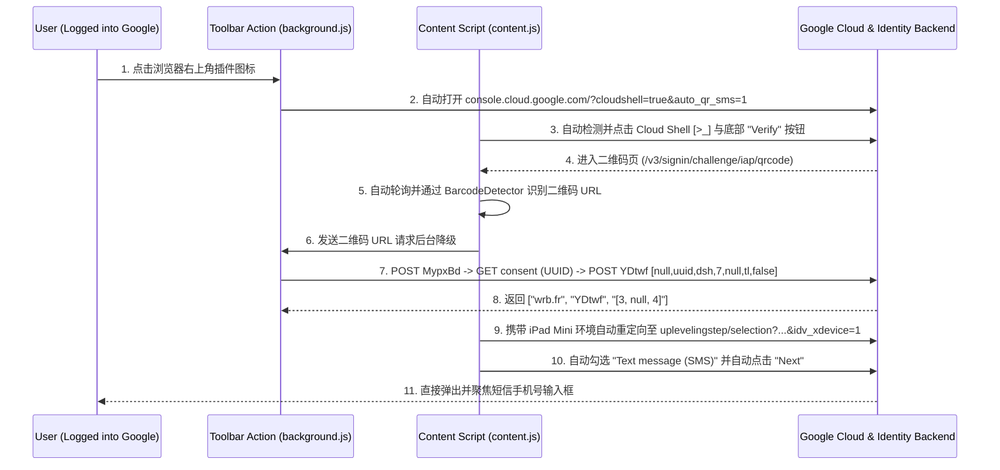

# Google QR SMS Auto (`google-qr-sms-auto`)

<p align="center">
  
  
  
  
</p>

<p align="center">
  <b>一键全自动将 Google 桌面端强制跨设备扫码验证（MO-SMS / GMS Constellation）降级并自动弹出「短信手机号输入框」。</b><br/>
  One-click full automation: Navigate to Google Cloud Console, trigger Cloud Shell Verify, inject <code>[3,null,4]</code> fallback state, and auto-open the 6-digit SMS phone input box.
</p>

---

## 🙏 致谢与借鉴出处 (Credits & Acknowledgements)

本项目基于 **[havenicec/google-qr-sms-helper](https://github.com/havenicec/google-qr-sms-helper)** 二次开发与自动化升级，特此向原作者 **[@havenicec](https://github.com/havenicec)** 致谢！

- **原项目地址**：[https://github.com/havenicec/google-qr-sms-helper](https://github.com/havenicec/google-qr-sms-helper)
- **核心技术原理来源**：
  - 原项目提出的 **Google Cloud Console (`Cloud Shell -> Verify`) 纯净 `continue` 参数入口方案**；
  - 原项目逆向分析的 **`MypxBd` + `YDtwf ([null, uuid, dsh, 7, null, tl, false])` -> `[3, null, 4]` 非 Android 设备短信回退 RPC 注入机制**；
  - 原项目通过 `declarativeNetRequest` 与 `MAIN` world 脚本在全链路（含 `/_/IdvUplevelingUi/data/batchexecute`）保持 **`iPad Mini` (`Mobile/15E148`) 环境伪装**的方案。

### ✨ 本项目 (`google-qr-sms-auto` v2.0) 的改进点

在原项目需要分步手动访问网页、手动点击悬浮窗按钮、手动选择短信单选框的基础上，本项目实现了**从点击插件图标到弹出短信手机号输入框的全流程无人值守自动化**：

1. **工具栏图标一键启动 (`chrome.action.onClicked`)**：只要浏览器已登录 Google 账号，点击右上角扩展图标，即刻自动跳转至 `https://console.cloud.google.com/?cloudshell=true&auto_qr_sms=1`。
2. **自动唤起 Cloud Shell Verify**：进入 Google Cloud Console 后自动轮询检测并点击右上角 Cloud Shell 终端按钮 `[>_]` 及底部弹出的 `Verify` / `验证` 按钮。
3. **二维码渲染即刻自动注入**：进入 `/v3/signin/challenge/iap/qrcode` 页面后无需人工点击，自动轮询等待二维码图片加载完成，调用浏览器原生 `BarcodeDetector` 提取链接并在后台完成 `[3,null,4]` 状态注入与 `idv_xdevice=1` 重定向。
4. **自动勾选短信并弹出手机号输入框**：跳转至 `/uplevelingstep/selection` 验证方式选择页后，自动识别并勾选 **「Text message (SMS) / 短信」** 单选框，自动点击 **「Next / 下一步」**，直接弹出并聚焦**短信手机号输入框**。

---

## 📦 一、安装教程 (Installation)

### 方式 1：通过 Git 克隆安装
```bash
git clone https://github.com/havenicec/google-qr-sms-helper.git # 原项目
# 或克隆本仓库后加载解压的扩展程序
```

### 方式 2：加载本地文件夹
1. 下载或克隆本仓库到本地文件夹。
2. 打开 Chrome / Edge / Brave 浏览器，在地址栏输入 `chrome://extensions/`（Edge 输入 `edge://extensions/`）并回车。
3. 打开页面右上角的 **「开发者模式 (Developer mode)」** 开关。
4. 点击左上角的 **「加载已解压的扩展程序 (Load unpacked)」**，选中本项目文件夹即可完成安装。
5. 点击浏览器右上角扩展拼图图标，将 **「Google 一键自动降级短信助手」** 固定（Pin）到工具栏。

---

## 🚀 二、使用教程 (Usage Guide)

1. **登录账号**：在浏览器中登录你需要进行验证的 Google 账号。
2. **点击插件图标**：直接点击浏览器右上角工具栏上的 **「Google 一键自动降级短信助手」** 图标。
3. **全自动执行（无需人工干预）**：
   - 插件自动导航至 `https://console.cloud.google.com/?cloudshell=true&auto_qr_sms=1`；
   - 自动触发 Cloud Shell 并点击底部的 **`Verify`** 按钮；
   - 自动在二维码页面识别二维码并在后台注入 `[3,null,4]` 降级状态；
   - 自动跳转到 `/uplevelingstep/selection` 页面，自动勾选 **Text message (SMS) / 短信** 并点击 **Next / 下一步**；
   - 页面直接弹出并聚焦**短信手机号输入框**。
4. **输入手机号接码**：在手机号输入框中填入你的接码手机号，输入收到的 6 位 `G-xxxxxx` 验证码即可完成账号验证，全局解锁 Google Cloud Shell / Antigravity / Gemini CLI 权限。

> [!TIP]
> 页面右下角依然保留了可视化状态悬浮窗与手动兜底按钮，方便实时查看当前自动化进度或在网络卡顿时手动重试。

---

## ✨ 三、全自动工作流架构 (Architecture & Workflow)



---

## 📁 四、目录结构 (Project Structure)

```text
google-qr-sms-auto/
├── manifest.json   # Chrome Extension Manifest V3 配置（含 action 点击触发与 DNR 权限）
├── background.js   # 工具栏一键导航 + DNR 全路径 iPad Mini 伪装 + [3,null,4] RPC 注入
├── content.js      # Console 自动点 Verify + 二维码自动检测注入 + 自动选短信弹出输入框
├── ua_spoof.js     # Main-world navigator iPad Mini 属性对齐
├── .gitignore      # Git 忽略规则
├── LICENSE         # MIT 开源许可证（保留原作者 havenicec 版权声明）
└── README.md       # 项目文档与借鉴出处说明
```

---

## 📄 五、开源协议 (License)

本项目基于 [MIT License](./LICENSE) 开源，保留原项目 [havenicec/google-qr-sms-helper](https://github.com/havenicec/google-qr-sms-helper) 的 MIT 版权声明。
友情链接：LinuxDo 开源社区(https://linux.do/)
